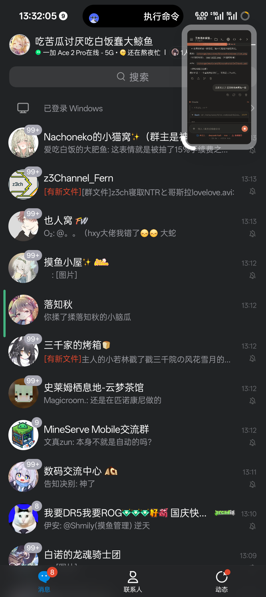
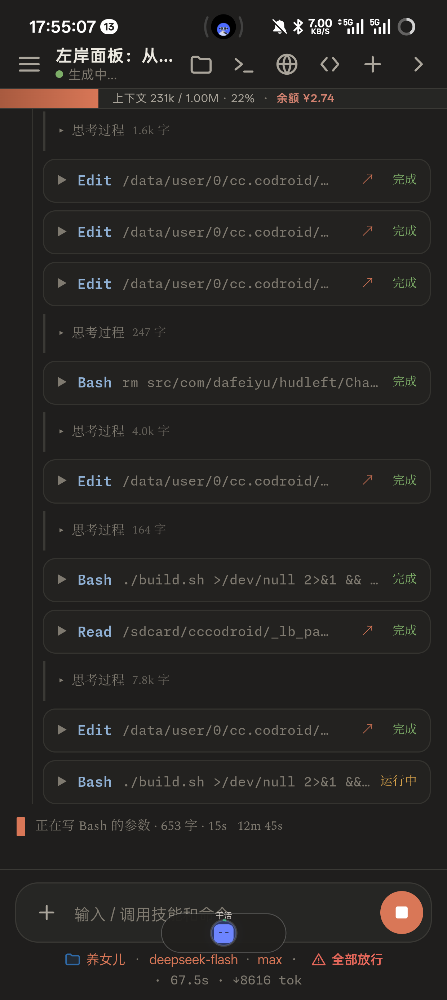
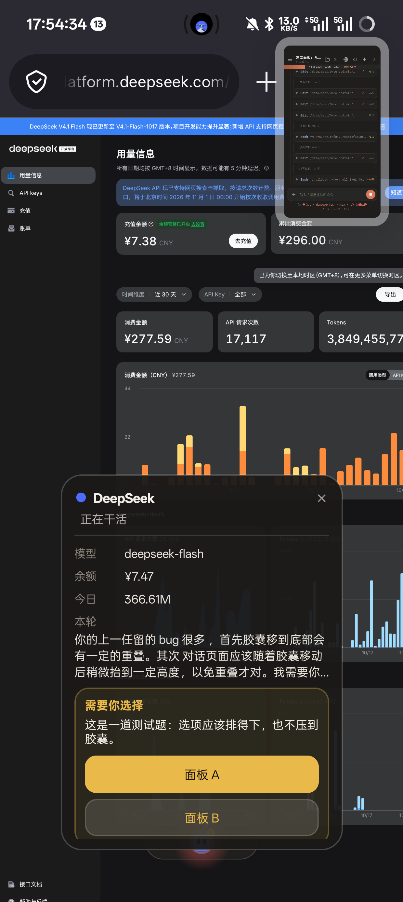
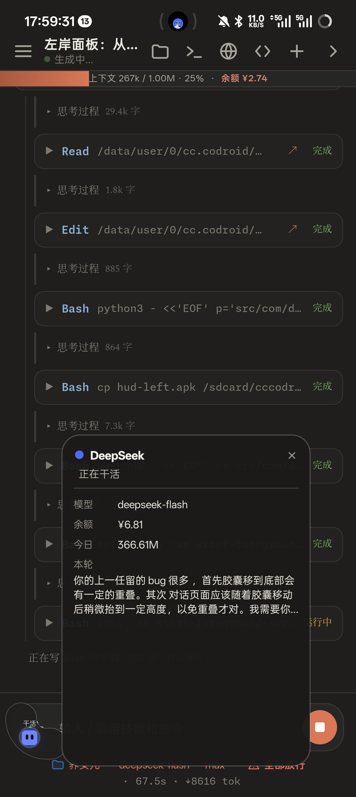
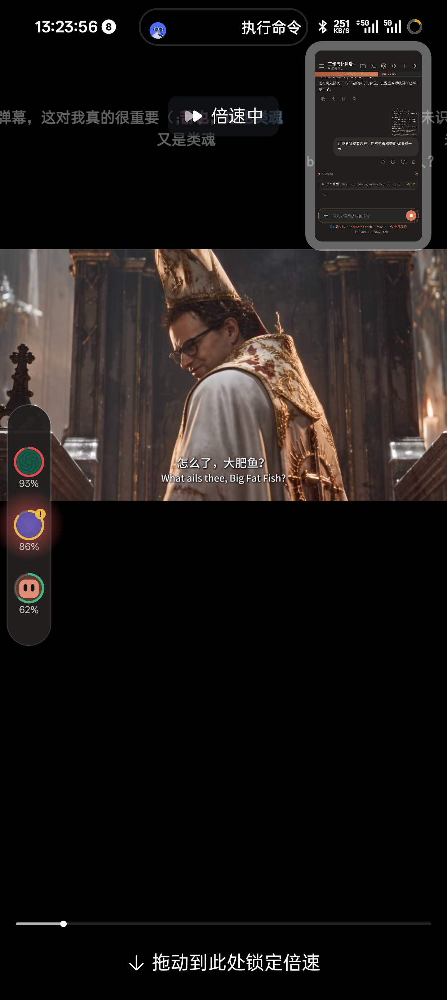

# 左岸 · LeftBank

跑在安卓屏幕边框上的一条「工作状态灯带」，外加一扇贴身的监察窗：能看 cccodroid 里 Claude 的实时状态、余额、今日用量和本轮在做什么，也能在遇到选择题或权限确认时直接作答。

> 仅在一台 OnePlus PJA110（Android 16 / ColorOS 16）上验证，测试阶段。

## 它是什么

- **收起**：边框上一条 60dp 的短线，按状态变色（空闲绿、干活铜、等你红）；
- **展开**：沿边框路径走的胶囊，里面是模型图标和状态；没有加号，点模型图标开合监察窗；
- **拐角**：胶囊沿边框路径描出来，滑到拐角会跟着圆弧弯折；
- **监察窗**：状态 / 模型 / 余额 / 今日 token / 本轮工作；有请求时出选项按钮；
- **作答**：`AskUserQuestion` 的选项最多四个；权限确认是「允许 / 拒绝 / 始终允许」，回写 `/api/perm/answer`；
- **月亮规则**：监察窗沿胶囊朝屏幕内侧的法线退开，与灯带保持固定 14dp；角上用灯带采样做碰撞，只会更远，不会重叠；
- **触控贴着胶囊**：展开窗口 140dp，手指必须落在胶囊上（垂直 34dp、沿路径不超过胶囊半跨 + 10dp），旁边空白不误触。

## 截图

| 收起 | 展开 | 监察窗 | 角上 |
|---|---|---|---|
|  |  |  |  |

拐角弯折：

## 依赖与前提

- Android 8.0+（`minSdk 29`），需要「显示在其他应用上层」权限；
- 需要本机运行 **cccodroid**（`greyoak111/cccodroid`）作为数据源，网关默认监听 `127.0.0.1:8791`；
- 网关 `/api/*` 需要 `X-CC-Token` 头。令牌在 cc 的私有目录 `.gateway-token`，本应用读不到，需要先拷到本应用的媒体目录：

```sh
mkdir -p /sdcard/Android/media/com.dafeiyu.hudleft
cp <cc-home>/.gateway-token /sdcard/Android/media/com.dafeiyu.hudleft/gateway-token
```

- 明文 HTTP 需要 `android:usesCleartextTraffic="true"`（已写在清单里）。

## 构建

没有用 Gradle，和 cccodroid 一样走 aapt2 + javac + d8：

```sh
cd source
./build.sh        # 需要 android.jar（SDK 36）与 apksigner
```

`build.sh` 里 `SDK` 指向一个 android.jar 的路径，按你的环境改。

## 接口

| 用途 | 接口 |
|---|---|
| 状态 / 轮次 / 待确认请求 | `GET /api/state` |
| 余额 | `GET /api/billing` |
| 今日 token | `GET /api/usage` |
| 回答权限 / 选择题 | `POST /api/perm/answer` |

## 调试入口

```sh
am start-foreground-service -n com.dafeiyu.hudleft/.HudService \
  -a com.dafeiyu.hudleft.TEST --ef x 30 --ef y 2650 \
  --ez expand true --ez chat true [--ez demo true]
```

把胶囊放到指定屏幕坐标、展开、打开监察窗；`demo` 会注入一道演示题，方便看选项按钮。

## 已知限制

- 只有一台真机验证；其他 ROM 的悬浮窗与手势行为未测；
- 监察窗的真实 `AskUserQuestion` / 权限回写链路在「卡片版」实测通过；改成监察窗后接口未变，但还没重新做一轮真实的端到端回归；
- 多轮 `runs[]` 与 SSE 步骤未接（仍是 2 秒轮询，请求最多延迟 2 秒）；
- 窗口外真正的「点击透传」要隐藏 API `ViewTreeObserver` 的 touchable region（SDK 里没有），目前用「140dp 小窗 + 命中判定」：窗口内、胶囊外的点击不传给下面的应用，但不会误触胶囊；
- 设置页里的「磁吸范围」滑杆已无意义，尚未移除。

## 许可

本项目以 Apache-2.0 发布，见 `LICENSE`；引用的第三方见 `THIRD_PARTY.md` 与 `docs/03-引用的项目与许可.md`。
