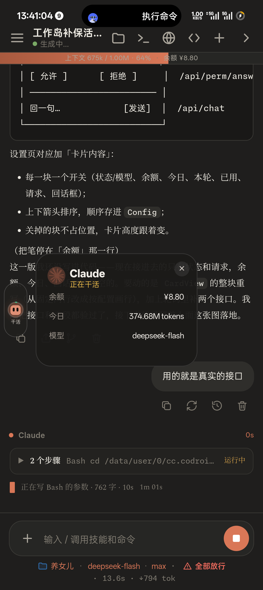

# 左岸 · LeftBank

跑在安卓屏幕边框上的一条「工作状态灯带」，把 cccodroid 里 Claude 的实时状态、余额、用量和待确认的请求，做成一条贴边的胶囊。

> 仅在一台 OnePlus PJA110（Android 16 / ColorOS 16）上验证，测试阶段。

## 它是什么

- **收起**：边框上一条 60dp 的短线，按状态变色（空闲绿、干活铜、等你红）；
- **展开**：沿边框路径走的 30dp 胶囊，里面是模型和状态；
- **拐角**：胶囊沿边框路径描出来，滑到拐角会跟着圆弧弯折；
- **真实数据**：状态 / 轮次来自 cccodroid 网关 `/api/state`，余额 `/api/billing`，今日用量 `/api/usage`；
- **能答请求**：权限确认与 AskUserQuestion 都能在卡片上点，回写 `/api/perm/answer`。

## 截图

| 收起 | 展开 | 卡片 | 拐角 |
|---|---|---|---|
|  |  |  |  |

## 依赖与前提

- Android 8.0+（`minSdk 29`），需要「显示在其他应用上层」权限；
- 需要本机运行 **cccodroid**（`greyoak111/cccodroid`）作为数据源，网关默认监听 `127.0.0.1:8791`；
- 网关 `/api/*` 需要 `X-CC-Token` 头。令牌在 cc 的私有目录 `.gateway-token`，本应用读不到，需要先拷到本应用的媒体目录：

```sh
mkdir -p /sdcard/Android/media/com.dafeiyu.hudleft
cp <cc-home>/.gateway-token /sdcard/Android/media/com.dafeiyu.hudleft/gateway-token
```

- 明文 HTTP 需要 `android:usesCleartextTraffic="true"`（已写在清单里）。

## 构建

没有用 Gradle，和 cccodroid 一样走 aapt2 + javac + d8：

```sh
cd source
./build.sh        # 需要 android.jar（SDK 36）与 apksigner
```

`build.sh` 里 `SDK` 指向一个 android.jar 的路径，按你的环境改。

## 接口

| 用途 | 接口 |
|---|---|
| 状态 / 轮次 / 待确认请求 | `GET /api/state` |
| 余额 | `GET /api/billing` |
| 今日 token | `GET /api/usage` |
| 回答权限 / 选择题 | `POST /api/perm/answer` |

## 已知限制

- 只有一台真机验证；其他 ROM 的悬浮窗与输入法行为未测；
- 卡片里的「始终允许」接口已接，按钮尚未画；
- 卡片行的显隐 / 排序设置未实现；
- 状态轮询 2 秒一次，不是 SSE，请求出现最多延迟 2 秒。

## 许可

本项目以 Apache-2.0 发布，见 `LICENSE`；引用的第三方见 `THIRD_PARTY.md` 与 `docs/03-引用的项目与许可.md`。
